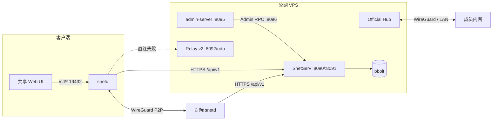

# SNET 设计文档

> 基线：`v1.2.1` / 代码 `HEAD`（2026-11-21）。
> 本文以 `cmd/`、`internal/`、`shared/web/` 代码为准；旧版设计中的 Tauri、固定服务器地址、32 个 gomobile 方法等描述已过时。
> 维护规则：结构、端口、API、数据模型变化时同步更新本文；细节排障放 `docs/`。

## 1. 产品定位与边界

SNET 是面向个人、家庭和小团队的 WireGuard 虚拟组网工具：

- 把分散在各地的 Mac、Windows、Android、NAS、Linux 设备加入同一个虚拟网络；
- 优先 LAN / IPv6 / NAT 打洞直连，直连失败回退 Relay v2；
- 支持标准 WireGuard 客户端通过 `.conf` 或二维码接入；
- 支持把成员背后的物理子网（如 `10.7.86.0/24`）委派给其他成员访问。

边界：

- **协调服务不转发业务数据**，除非客户端显式选择中继兜底。
- **数据面是 WireGuard**，端到端加密；协调面只负责注册、发现、探测和票据签发。
- **每个网络绑定一个 SnetServ**；客户端按网络路由请求，不再假设全局唯一服务器。

## 2. 技术架构

### 2.1 控制面与数据面

| 面 | 组成 | 职责 |
|---|---|---|
| 协调控制面 | SnetServ（`cmd/snetserv`） | 网络/节点/设备注册、邀请与审批、peer 列表、Relay v2 票据、probe |
| 本地控制面 | `snetd` 的 `/ctl/*`（`127.0.0.1:19432`） | 客户端 UI 管理隧道、网络、NAT、路由、日志 |
| 平台管理面 | `admin-server` + 内部 Admin RPC | 管理员登录、网络/设备/审批/统计；不把服务令牌暴露给浏览器 |
| 数据面 | WireGuard（wireguard-go） | 节点间加密隧道；直连优先，Relay v2 兜底 |
| 中继面 | Relay v2（`cmd/relay`） | 无状态 UDP session 转发，按节点 ID 精确投递 |
| 公网入口 | Official Hub | 由服务端配置的常驻节点，作为手机/外部 WireGuard 的公网出口 |

### 2.2 组件地图

| 组件 | 入口 | 职责 |
|---|---|---|
| SnetServ | `cmd/snetserv` | 公网 API `:8090`、UDP probe `:8091`、可选 legacy relay、Relay v2 票据、loopback Admin RPC `:8096` |
| Admin Server | `cmd/admin-server` | 管理台 `:8095`、登录 session、把请求转发到 loopback Admin RPC |
| Relay v2 | `cmd/relay` | 独立 UDP relay `:8092`，metrics 默认 `127.0.0.1:8094` |
| 客户端守护进程 | `cmd/client/snetd` | WireGuard 隧道、peer 轮询、NAT 探测/映射、路径管理、密钥轮换、`/ctl/*` |
| 客户端 CLI | `cmd/client/snetctl` | 调用本地 `/ctl/*` |
| 共享 Web UI | `shared/web` | 桌面、Docker、Android WebView 共用的唯一 UI |
| 管理台 UI | `internal/adminui` | `go:embed` 的 `admin.html` |
| Android 桥 | `snetbind` | gomobile 导出：`Start` / `Stop` / `ClearAndroidTun` / `GetStatus` |

### 2.3 部署形态



## 3. 目录结构

```text
cmd/
  snetserv/                公网协调服务 + loopback Admin RPC
  admin-server/            独立管理台
  server/                  兼容单进程入口（含内置 /admin）
  relay/                   Relay v2
  client/snetd/            Go 守护进程
  client/snetctl/          本地 CLI

internal/
  server/                  HTTP 路由、Store、bbolt、legacy relay、probe、Hub、WireGuard 导出
  relay/                   Relay v2 session、ticket、限流、metrics
  client/                  daemon、/ctl、控制 API、配置、隧道、路径管理、NAT、网关、设备身份
  protocol/                共享类型、snet:// 链接、Relay v2 帧
  adminclient/             admin-server → SnetServ 内部 RPC 客户端
  adminui/                 go:embed 管理台页面
  buildinfo/               版本/提交/构建时间
  constants/               官方默认协调地址等构建期常量

shared/web/                共享 UI（index.html、styles.css、ui.ts、types.ts、subnet.ts、utils.ts）
snetbind/                  Android gomobile 绑定
android/app-native/        Android Kotlin + WebView 客户端
desktop-mac-v3/            macOS Wails v3 客户端
desktop-windows/           Windows Wails v3 客户端
deploy-prod/               生产部署（Docker 客户端 / 服务端 / 手写 systemd）
deploy/                    传统部署脚本与运维文档
scripts/                   构建、发布、安装、E2E、硬件脚本
docs/                      设计/部署/排障/决策文档
archive/                   历史客户端与产物（不参与构建）
```

## 4. 核心业务

### 4.1 网络生命周期

```text
创建网络 → 自动分配 10.88.x.0/24 或使用指定网段
  → 生成 pairingCode（默认 72h / 5 次使用）
  → 返回 networkId、节点 IP、节点 token、邀请链接
  → 分享 snet://join?nid=...&code=...[&name=...][&s=...]
  → 其他设备加入：免审批直接分配，或进入 pending
  → owner 审批后领取节点 token 与 peers
  → 建立 WireGuard 隧道 → 访问成员或委派子网
```

- 角色只有 `owner` 和 `member`。owner 可转让；legacy `admin` 角色被拒绝。
- 每台设备在每个 SnetServ 上只能创建一个自有网络（Store 按本服务端网络集合校验）。
- `managed` 网络由服务端创建：无网主、不参与僵尸清理、配对码长期有效。
- 普通网络默认 72 小时无在线即被僵尸清理；清理任务每 10 分钟运行一次。

### 4.2 邀请与加入

- 邀请链接：`snet://join?nid=<nid>&code=<code>[&name=<name>][&s=<加密服务器>]`。
- `s=` 是 AES-GCM 加密后的 SnetServ 地址，避免链接里出现明文服务器。
- 链接携带的服务器优先；无 `s=` 时回退官方默认 `https://snet.uizhi.eu.org:8090`。
- 不再存在“可配置的全局默认服务器”；客户端按网络记录自己的 `snetServUrl`。
- `approvalRequired=false`：知道 code 即可加入；`true`：进入 pending，owner 审批后一次性 claim。
- `POST /ctl/rotate-invite` 会立即让旧链接失效。

### 4.3 设备身份与恢复

- 每台客户端持久化 `device.id` + WireGuard 密钥对 + `ctl-token`。
- 设备身份来源：macOS `IOPlatformUUID`、Windows `MachineGuid`、Linux DMI `product_uuid` / `machine-id`、Android 应用持久目录。
- 服务端按 `deviceId` 注册设备；重装后可用设备级 recovery token 拉回历史网络。
- `recoveryTokens` 按 SnetServ 保存；启动时逐服务器同步，避免多服务端互相覆盖。

### 4.4 连接建立与选路

```text
每 15s UDP probe :8091 → 观测公网 IP:port
  → 候选优先级：同 LAN > 全局 IPv6 > 公网打洞
  → 打洞候选：观测端口 ±1..±8，共 17 个（并行 5 个/批）
  → 直连 5s ping；15s 无包或发送失败 → 回退 relay
  → 已建立低优先级路径时每 10s 探测更高候选
```

- **Relay v2 启用（默认 PathManager）**：先建 relay session，同时探测直连；直连成功后
  无感切换。30s 仍未直连时 UI 按 relay 路径展示。
- **Relay v2 未启用**：走 legacy direct-first；20s 未完成握手回退 relay，180s 后重试直连。
- Relay v2：服务端签发 1h HMAC ticket；客户端 `HELLO` 建 session，`DATA` 按 `recipientID` 转发；MTU 1320。
- 每个 peer 使用 `127.0.0.1:Pi` loopback shim，WireGuard endpoint 不随路径变化。
- 多 relay：每个实例维持 HELLO/PING session，发送优先第一个 ready 实例，失败切其他实例。
- 自动端口映射：UPnP-IGD / NAT-PMP / PCP，默认开启；租约 5m、每 2m 续期。
- 只有网关 WAN IP 与 relay 观测公网 IP 一致时，映射端点才会标记 `EndpointMapped` 并广播。
- 同公网出口的 sibling 不走公共 IP hairpin 直连，固定 relay。
- 看门狗每 10s 采样；relay 路径连续 3 次无流量且握手过期时强制重选中继。

### 4.5 子网路由与网关

- owner 通过 `PUT /api/v1/networks/{nid}/routes` 委派 CIDR。
- 目标节点必须开启 `allowRelay` 且网关配置成功（IP 转发 + NAT），路由才从 pending 变 active。
- 成员端按 active CIDR 安装 WireGuard AllowedIPs 与系统路由；可逐 CIDR 开关。
- 成员视角的 peer 列表保留 `AllowedSubnets`（数据面需要），只清空 `Role`。
- 网关配置失败时节点上报 `relayError`，路由保持 pending，不静默假装可用。

### 4.6 官方 Hub 与 WireGuard 导出

- 服务端通过 `SNET_HUB_NODE_ID` / `SNET_HUB_PUBLIC_KEY` / `SNET_HUB_ENDPOINT` 配置官方 Hub。
- 启用后 Hub 作为网络成员加入（优先分配 `.254`），作为公网出口。
- owner 可选择 Hub 或自建公网节点生成标准 WireGuard 配置。
- 导出的私钥只保存在本机 daemon 配置，不上传协调服务器。

### 4.7 多 SnetServ

- `Network` 记录 `snetServUrl` / `snetServId`，邀请链接绑定网络自己的 SnetServ。
- 客户端 `APIManager` 按 URL 复用 API 客户端；每个网络独立路由。
- v1.2.0 起旧客户端（≤ v1.1.16）无法加入其他 SnetServ 的网络；升级顺序：先服务端、再全部客户端、最后分发跨服邀请。
- `admin-server` 当前只管理单个 SnetServ；多服务端联邦管理计划在 v1.3。

## 5. 数据模型

### 5.1 服务端 bbolt（9 个 bucket）

| Bucket | Key | 说明 |
|---|---|---|
| `networks` | networkId | 网络基础数据、邀请码状态、路由、SnetServ 绑定 |
| `nodes` | `netId/nodeId` | 节点 IP、公钥、endpoint、NAT、relay 拓扑 |
| `tokens` | SHA-256(token) | token → 网络/节点映射 |
| `devices` | deviceId | 设备注册信息、公钥、名称、最后公网地址 |
| `pending` | pendingId | 待审批加入请求 |
| `admin` | username | 内置管理台 bcrypt 密码（兼容入口） |
| `authcodes` | authCodeId | 设备授权码（历史/预留，当前 HTTP 未挂载） |
| `relaytopo` | `netId/nodeId` | 每节点 relay 端口/主机拓扑 |
| `meta` | `serverId` | 本实例稳定身份（`srv_<16 hex>`），联邦化管理使用 |

所有读走内存缓存；需要重启保留的写入必须同时更新内存与 bbolt `persist*`。

### 5.2 关键协议结构

```go
type Network struct {
    ID, PairingCode, OwnerNodeID, CreatedAt string
    Name, Subnet, OwnerDeviceID string
    LastActivityAt int64
    RelayPort, NodeCount int
    Online, ApprovalRequired, Managed bool
    PendingCount int
    Description string
    Tags []string
    Visibility string      // "" | "private" | "shareable"
    Routes []Route
    HubNodeID string
    UseHubNode bool
    SnetServURL, SnetServID string
}

type Node struct {
    ID, NetworkID, IP, IPv6 string
    PublicKey, Endpoint, EndpointV6, LocalEndpoint string
    DirectEndpoint, DirectEndpointV6 string
    NATType string
    EndpointMapped bool
    LastSeen int64
    DeviceID, DeviceName string
    RelayFlow string
    RelayPort int
    RelayHostOverride string
    Online bool
    AllowedIPs []string
    Role string            // "owner" | "member"
    AllowRelay bool
    RelayError string
    IsHub bool
}
```

### 5.3 客户端配置

- 文件：`config.json`（Docker / 桌面），含 `deviceId`、`privateKey`、`networks`、`pendingJoins`、`recoveryTokens`、`natMapping`、`allowRelay`、`routeEnabled`、`webPasswordHash`。
- 每个网络单独记录 `SnetServURL` / `SnetServID`，不再依赖全局服务器字段。
- 配置与 `device.id`、`ctl-token` 同目录，权限 `0600`；私钥不上传。

## 6. API

> 端点数量以代码为准；下面是分组与关键路径。

### 6.1 SnetServ 公网 API

- 路由表：`internal/server/server.go`，约 34 个 `/api/v1/*` 端点 + `/healthz`。
- 公开：创建网络、加入、注册设备、pending 查询/取消。
- 节点 token：peer 列表、endpoint、direct-endpoints、relay ticket、路由、审批、踢人、删除、认领、WireGuard 配置。
- 版本头：`X-Snet-Api-Version`，主版本不匹配返回 426；响应带 `X-Snet-Server-Version`。

### 6.2 客户端本地 `/ctl/*`

- 路由表：`internal/client/ctl.go`，约 39 条注册（业务 + 4 条 auth）。
- 鉴权：`X-Ctl-Token`；Docker Web 经 nginx 注入 `X-Snet-Web: 1`，还必须带有效 Web session。
- 关键端点：`/ctl/create`、`/ctl/join`、`/ctl/status`、`/ctl/peers`、`/ctl/invite`、`/ctl/rotate-invite`、`/ctl/approve`、`/ctl/routes`、`/ctl/relay`、`/ctl/nat`、`/ctl/wireguard-config`。

### 6.3 管理面

| 形态 | 入口 | 鉴权 |
|---|---|---|
| 管理台 | `cmd/admin-server` `:8095` | 环境变量账号密码登录 session |
| 内部 RPC | SnetServ `127.0.0.1:8096/internal/admin/*` | `X-Internal-Admin-Token` + loopback 或私有 Compose 网络 |

公网 API `:8090` 不挂载 `/admin`；访问 `https://<host>:8090/admin` 返回 404。

`admin-server` 只转发白名单数据端点，登录/初始化/改密不会经内部 RPC 暴露。

内部健康端点：`GET /internal/admin/health`（仅 loopback + `X-Internal-Admin-Token`）
返回 `serverId`、`snetServUrl`、`version`、`apiVersion`、`startedAt` 与网络/设备/节点计数。

## 7. 前端与平台

### 7.1 共享 Web UI

- `shared/web/types.ts` 的 `Backend` 是唯一平台接缝；`shared/web/ui.ts` 负责渲染与交互。
- Docker 适配器：`deploy/docker/web-build/web.ts`；桌面通过 Wails 的 `ctlProxy` 代理 `/ctl/*`。
- 修改 `shared/web/*` 后必须重新构建 Web 资产，否则 Docker/桌面产物仍是旧版。

### 7.2 macOS / Windows

- 均为 Wails v3 应用，内嵌共享 Web UI，通过 `ctlProxy` 访问 `127.0.0.1:19432`。
- macOS：LaunchDaemon 常驻 `snetd`，配置在 `/usr/local/etc/snet`。
- Windows：安装包注册 `SNetDaemon` 服务；便携模式用 UAC 启动 `snetd.exe`；依赖 Wintun；配置在 `C:\ProgramData\SNET`。

### 7.3 Android

- Kotlin + WebView + gomobile AAR；`SnetVpnService` 持有 TUN fd，`snetbind` 启动 daemon。
- 单网络模式：连接或创建另一个网络会提示并断开当前网络。
- MTU 1320；按实际网络 CIDR 与 peer 子网安装路由，不固定注入 `10/8`。

### 7.4 Docker / NAS

- 镜像内含 `snetd` + nginx + 共享 Web UI，`network_mode: host`、`NET_ADMIN`、`/dev/net/tun`。
- Web 端口 `8081`；WireGuard 端口建议 `52100+`，避开 legacy relay 池。
- 数据卷挂载到 `/etc/snet`；配置、`device.id`、`ctl-token` 都在其中。

## 8. 端口与配置路径

| 用途 | 端口 | 说明 |
|---|---|---|
| 协调 API | `8090/tcp` | HTTPS/JSON |
| UDP probe | `8091/udp` | 公网地址发现 |
| Relay v2 | `8092/udp` | 无状态转发 |
| Relay metrics | `8094/tcp` | 默认仅 loopback |
| Admin UI | `8095/tcp` | `admin-server` |
| 内部 Admin RPC | `8096/tcp` | 仅 loopback + 服务令牌 |
| Legacy relay | `51820-52075/udp` | 每网络懒绑定 |
| 本地控制 | `19432/tcp` | `/ctl/*`，仅本机 |
| Docker Web | `8081/tcp` | nginx |
| 成员 Docker WG | `52100+/udp` | 避开 relay 池 |

| 平台 | 配置目录 |
|---|---|
| macOS | `/usr/local/etc/snet` |
| Windows | `C:\ProgramData\SNET` |
| Docker / NAS | `/etc/snet` |
| Android | 应用私有 `filesDir` |

## 9. 构建与测试

```bash
# Go
go build ./...
go test ./...
go vet ./...

# Web
./scripts/build-web.sh
cd shared/web && npx --yes -p typescript@5.9.3 tsc --noEmit -p tsconfig.json

# 发布产物
./scripts/build-release.sh
```

`snetd` 的交叉编译必须保留平台文件组（`tunnel_*`、`gateway_*`、`relaygateway_*`、`service_*`），否则目标平台构建失败。

## 10. 关键决策与已知局限

| 决策 | 选择 | 理由 |
|---|---|---|
| 数据面 | WireGuard | 性能、内核级加密、标准客户端可接入 |
| 协调面 | HTTPS REST JSON | 简单、跨语言、易排障 |
| 中继 | Relay v2 UDP | 无状态、低延迟、不改 WireGuard |
| 存储 | bbolt | 嵌入式、零外部依赖 |
| 前端 | 共享 TS + Backend 接口 | 多端复用 |
| 服务器模型 | 每网络绑定 SnetServ | 支持自托管与跨服邀请 |
| UI 渲染 | 模板字符串 | 轻量、无框架依赖 |

已知局限：

- 协调服务无集群/同步，单点故障；需备份 `snet.db`。
- `internal/client/daemon.go` 仍然很大，职责偏重。
- Relay 无二次加密（依赖 WireGuard 端到端加密；多租户公服需另行评估）。
- `admin-server` 尚未支持多 SnetServ 联邦管理。
- `authcodes` bucket 与 `BindDevice` 代码保留，但当前没有公开 HTTP 路由。
- 社区共享仅存储/展示 `description` / `tags` / `visibility`，公开目录发现未落地。

## 11. 迭代记录

| 版本 | 内容 |
|---|---|
| v1.2.2-dev | 退役 `cmd/server`：主服务端统一 `cmd/snetserv`，管理台独立 `cmd/admin-server`；公网 API 不再挂载 `/admin`；发布产物为 `snetserv` + `admin-server` + `relay` + 客户端。 |
| v1.2.0 | 每网络绑定 SnetServ（`snetServUrl` / `snetServId`）；邀请链接加密服务器字段；客户端 `APIManager` 按服务器路由；owner 配额按 SnetServ；拆分 `cmd/snetserv` 与 `cmd/admin-server`；客户端升级到 Wails v3；Android 恢复为交付目标（单网络）；管理台邀请链接修复。 |
| v1.2.1 | 管理台邀请链接改用网络绑定 SnetServ；移除全局默认协调服务配置；修复多网络 WireGuard UDP 端口冲突与启动加载态；Windows/macOS 托盘多网络直列与状态图标统一；修复节点心跳写入与删除竞态。 |
| v1.1.x | Windows 多网络、加密邀请、客户端刷新、VPN 生命周期与 LAN fallback；打包与签名修复。 |
| v1.1.0 | 统一版本与发布：`VERSION` + `buildinfo`、CI/Release、Android 签名、`build-release.sh`、NAT 自动映射、Relay 共享出口。 |
| v0.12.0 | 启动授权复查与网络同步；授权码过期端到端。 |
| v0.11.0 | 固定协调地址、邀请链接异地址拒绝。 |
| v0.10.0 | Relay 懒绑定 + 端口池扩容、API 版本协商、路径遥测、对称 NAT 候选、密钥轮换。 |
| v0.9.x | `/ctl/*` token + bcrypt、Android VPN 线程安全、中继 fan-out。 |
