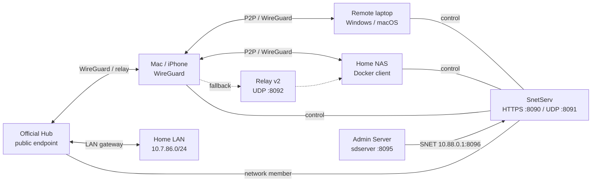

<div align="center">

# Snet

**建立一个独属于你的私人或办公网络，无论你在何处，你的网络始终都在线**

 P2P 直连 + 按需中继 · macOS / Windows / Android / NAS / IOS

[](LICENSE)
[](https://github.com/S-shidi/Snet/releases/latest)
[](https://github.com/S-shidi/Snet/actions/workflows/ci.yml)
[](https://github.com/S-shidi/Snet/actions/workflows/build-mac.yml)
[](https://github.com/S-shidi/Snet/actions/workflows/build-windows.yml)

[](https://github.com/S-shidi/Snet/releases/latest)
[](https://github.com/S-shidi/Snet/releases/latest)
[](https://github.com/S-shidi/Snet/releases/latest)
[](https://github.com/S-shidi/Snet/blob/master/deploy-prod/docker-client/README.md)

</div>

<div align="center">
  
  <p><sub>Snet 控制台：网络状态、设备在线情况、直连 / 中继路径、公网地址与子网路由</sub></p>
</div>

## ✨ 为什么是 Snet

Snet 是一个开箱即用的私有网络。试想当离开公司或家你该如何访问公司与家的网络或服务，有了它Snet这将不是问题，Snet帮你组件一个独有的虚拟网络，将你多地的设备全部加入到这个网络，你将体验到如同本地局域网访问体验。

- **全平台**：macOS、Windows、Android、Linux / Docker / 群晖 NAS；桌面端支持多网络并行，Android 采用稳定的单网络模式。
- **P2P 优先，按需中继**：LAN、IPv6、NAT 打洞优先；同 LAN 直连失败时自动尝试公网 hairpin，最后回退 Relay v2，不需要公网 IP。
- **路径与地址可见**：成员卡片展示真实公网地址、直连 / 中继状态、NAT 类型和子网路由，便于排障。
- **标准 WireGuard 接入**：一键生成 `.conf` 和二维码，手机、软路由、任何标准 WireGuard 客户端都能直接导入。
- **官方 Hub / 原生网关**：无需改造现有 LAN，通过 Hub 或委派路由访问 `10.7.86.0/24` 等内网网段。
- **适合自托管**：单个 Go 二进制、Docker Compose、SQLite/bbolt 持久化，没有外部数据库依赖。

## 🚀 Quick Start

### 1. 部署服务端

在 Linux VPS 上执行：

```bash
curl -fsSL https://raw.githubusercontent.com/S-shidi/Snet/master/scripts/install-server.sh | sudo bash
```

脚本会：

- 安装到 `/opt/snet`
- 生成 Relay 密钥
- 启动 `snetserv` + `snet-relay`
- 输出健康检查、Relay 和内部 RPC 地址
- 管理台需在 SNET 成员主机单独部署（见下方）

生产环境建议配置域名和 TLS，并阅读 [服务端部署文档](deploy-prod/docker-server/README.md)。

管理控制台运行在 SNET 成员主机（例如 sdserver），通过 SNET 虚拟网络访问
VPS 的内部 RPC；VPS 不暴露 8095/8096 到公网。部署见
[`deploy-prod/sdserver-admin/README.md`](deploy-prod/sdserver-admin/README.md)。

```text
http://<管理员主机内网IP>:8095/admin
```

### 2. 安装客户端

- **macOS（Apple Silicon）**：从 [Latest Release](https://github.com/S-shidi/Snet/releases/latest) 下载 `.dmg`
- **Windows**：从 [Latest Release](https://github.com/S-shidi/Snet/releases/latest) 下载 `Snet-v*-win-Setup.zip`，解压后运行安装程序（ZIP 可避免浏览器拦截未签名 `.exe` 下载）
- **Android**：从 [Latest Release](https://github.com/S-shidi/Snet/releases/latest) 下载 `Snet-v1.2.1-android.apk`（[直接下载](https://github.com/S-shidi/Snet/releases/download/v1.2.1/Snet-v1.2.1-android.apk)）。安装时需在系统设置中允许浏览器或文件管理器“安装未知应用”。该 APK 使用正式 Release keystore 签名；如果设备上装过旧版 debug 签名包，需要先卸载旧版再安装，之后即可同签名覆盖升级。Android 当前为单网络模式：连接或创建另一个网络时会提示并断开当前网络。
- **NAS / Linux**：[Docker 客户端部署](deploy-prod/docker-client/README.md)

客户端首次启动后打开 Web 控制台，设置管理密码。

#### macOS 终端安装

当前发布包为 Apple Silicon（arm64）。在“终端”中执行：

```bash
curl -fL -o /tmp/Snet-v1.2.1-mac.dmg \
  https://github.com/S-shidi/Snet/releases/download/v1.2.1/Snet-v1.2.1-mac.dmg

hdiutil attach /tmp/Snet-v1.2.1-mac.dmg -nobrowse
sudo cp -R "/Volumes/Snet Installer/Snet.app" /Applications/
sudo xattr -cr /Applications/Snet.app
hdiutil detach "/Volumes/Snet Installer"
open /Applications/Snet.app
```

首次启动会安装后台服务，系统可能要求输入管理员密码。升级时退出 Snet 后重复上述步骤即可。

### 3. 创建网络并邀请设备

1. 在客户端点击「添加网络」→「创建新网络」。
2. 把邀请链接发给另一台设备。
3. 对方在「加入网络」中粘贴链接。
4. 需要手机或标准 WireGuard 客户端接入时，继续看下一节。

### 4. iPhone / iPad 通过 WireGuard 接入

1. 在 App Store 安装 **WireGuard**。
2. 在 Owner 客户端打开网络详情 →「更多」→「生成 WireGuard 配置」。
3. 选择出口网关：
   - 已有官方 Hub：选择「官方中继 (Hub)」；
   - 自建公网节点：选择下一节部署的中继节点。
4. 点击「生成配置」，在 iPhone 的 WireGuard App 中点击 `+` → **从二维码创建**，扫描页面上的二维码。
   - 也可以复制配置文本，保存为 `.conf` 后通过「从文件或归档创建」导入。
5. 打开该隧道并允许 VPN 配置。iPhone 会作为「WireGuard 客户端」出现在网络成员中。

说明：

- 每个手机应单独生成一份配置，不要多台设备共用同一个配置。
- 配置的 `AllowedIPs` 只包含该网络网段和当前生效的委派路由，不是全局科学上网。
- 修改网络网段、删除/新增委派路由后，旧的手机构建不会自动更新，需要重新生成并导入配置。

### 5. 在公网服务器部署 WireGuard 中继节点

如果服务端已经配置官方 Hub，可跳过本节，直接在第 4 步选择官方 Hub。要让 iPhone 从一个自控的公网入口接入，可以在 VPS 上运行一个普通 Snet 客户端节点，并让它充当 WireGuard 出口网关。

前置条件：

- 公网服务器有固定公网 IPv4
- 已安装 Docker
- 防火墙放行 `UDP 51820`（或你自定义的 WireGuard 端口）
- 能访问协调服务 `https://<你的服务端>:8090`

创建配置目录：

```bash
sudo install -d -m 0700 /opt/snet-gateway
sudo tee /opt/snet-gateway/config.json >/dev/null <<'JSON'
{
  "wireguardPort": 51820,
  "networks": {},
  "keyRotationDays": 30,
  "natMapping": true,
  "allowRelay": true
}
JSON
sudo chmod 600 /opt/snet-gateway/config.json
```

启动中继节点：

```bash
sudo docker run -d \
  --name snet-gateway \
  --restart unless-stopped \
  --network host \
  --cap-add NET_ADMIN \
  --device /dev/net/tun \
  -v /opt/snet-gateway:/etc/snet \
  crpi-0ro5v5xbjp4autp9.cn-hangzhou.personal.cr.aliyuncs.com/snet/snet-client:v1.2.1
```

如果 Registry 提示未授权，请先登录对应镜像仓库，或使用自己构建的 `snet-client` 镜像。查看运行日志：

```bash
sudo docker logs -f snet-gateway
```

然后：

1. 浏览器打开 `http://<公网服务器IP>:8081`，设置 Web 管理密码。
2. 用网络的邀请链接加入目标网络。
3. 打开「设置」，确认「允许本设备作为中继网关」已开启。
4. 回到 Owner 客户端，在网络详情中生成 WireGuard 配置，选择这个节点作为出口网关。

注意：

- `8081` 只用于管理，建议通过防火墙限制来源；`51820/udp` 必须对公网开放。
- 公网 VPS 负责让手机接入 Snet 网络。若要访问家里的 `10.7.86.0/24` 等物理 LAN，应在家庭侧节点上开启中继网关并委派该网段，而不是只依赖公网 VPS。
- 若服务器已有其他服务占用 `51820`，请同时修改 `wireguardPort` 和防火墙规则。

## 🧭 架构



- **Client A ↔ Client B**：优先 LAN / IPv6 / NAT 打洞直连。
- **Client ↔ Relay**：直连失败时自动回退，Relay 不读取业务明文。
- **Client ↔ Hub ↔ LAN**：手机或外部 WireGuard 客户端通过 Hub 接入私有网段。
- **每个网络绑定一个 SnetServ**：邀请链接携带该网络的协调服务器；不再假设全局唯一服务器。
- **管理面独立**：`admin-server` 部署在 SNET 成员主机，经 SNET 虚拟网络访问内部 RPC；公网 API 不暴露 `/admin`。

## 🛠 技术栈

| 层 | 实现 |
|---|---|
| 数据面 | WireGuard（wireguard-go） |
| 协调面 | Go + HTTPS + bbolt；`cmd/snetserv` |
| 管理面 | `cmd/admin-server` + admin.html；部署在 SNET 成员主机，经 SNET 访问内部 RPC |
| 中继 | Relay v2，signed ticket，多实例候选；legacy relay 兼容 |
| 桌面客户端 | Wails v3（macOS / Windows）+ 共享 Web UI |
| Docker / NAS | snetd + Nginx + 共享 Web UI |
| Android | Kotlin + WebView + gomobile（单网络模式） |
| 标准 WireGuard | `.conf` + QR（手机、软路由、第三方客户端） |
| CI/CD | GitHub Actions（macOS DMG、Windows NSIS、Android APK、Docker ACR） |

## 📦 服务端 / 客户端

服务端、Relay 和客户端镜像：

```text
crpi-0ro5v5xbjp4autp9.cn-hangzhou.personal.cr.aliyuncs.com/snet/snet-snetserv:v1.2.1
crpi-0ro5v5xbjp4autp9.cn-hangzhou.personal.cr.aliyuncs.com/snet/snet-admin-server:v1.2.1
crpi-0ro5v5xbjp4autp9.cn-hangzhou.personal.cr.aliyuncs.com/snet/snet-relay:v1.2.1
crpi-0ro5v5xbjp4autp9.cn-hangzhou.personal.cr.aliyuncs.com/snet/snet-client:v1.2.1
```

> 服务端只运行 `cmd/snetserv`；管理台是独立的 `cmd/admin-server`，通过内部 RPC
> 管理数据，公网 API 不再暴露 `/admin`。

## 🔐 安全

- 数据面端到端由 WireGuard 加密；协调服务不接触业务明文。
- 服务端使用 HTTPS、Bearer Token、速率限制和严格 JSON body 限制。
- 客户端设备身份持久化；账号密码使用 bcrypt。
- 生成的 WireGuard 私钥只保存在本机 daemon 配置，不上传协调服务器。
- 漏洞披露：请通过 GitHub Security Advisories 私下报告，不要公开 Issue。

## 🧑‍💻 开发

```bash
go test ./...
./scripts/build-release.sh
```

客户端 UI：

```bash
cd desktop-windows/frontend && ./build-frontend.sh
```

## 📚 文档

- [文档总索引](docs/README.md)
- [系统设计](DESIGN.md)
- [项目全局图谱](docs/PROJECT-ATLAS.md)
- [服务端部署（Docker / TLS / Relay）](deploy-prod/docker-server/README.md)
- [Docker 客户端 / 群晖 NAS](deploy-prod/docker-client/README.md)
- [VPS 部署记录](docs/VPS-DEPLOY-VIA-HOSTODO.md)
- [部署环境与路径](docs/DEPLOYMENTS.md)
- [决策日志](docs/DECISION-LOG.md)
- [贡献指南](CONTRIBUTING.md)
- [安全策略](SECURITY.md)

## 📄 许可证

SNET 采用按组件拆分许可：

- 客户端组件：[BSD 3-Clause](LICENSE)
- 服务端与 Relay 组件：[AGPL-3.0-only](LICENSE)

闭源商业使用服务端代码需要单独商业许可，见 [COMMERCIAL.md](COMMERCIAL.md)。

---

<div align="center">
  <sub>Built with WireGuard, Go, Wails and a lot of NAT traversal.</sub>
</div>
