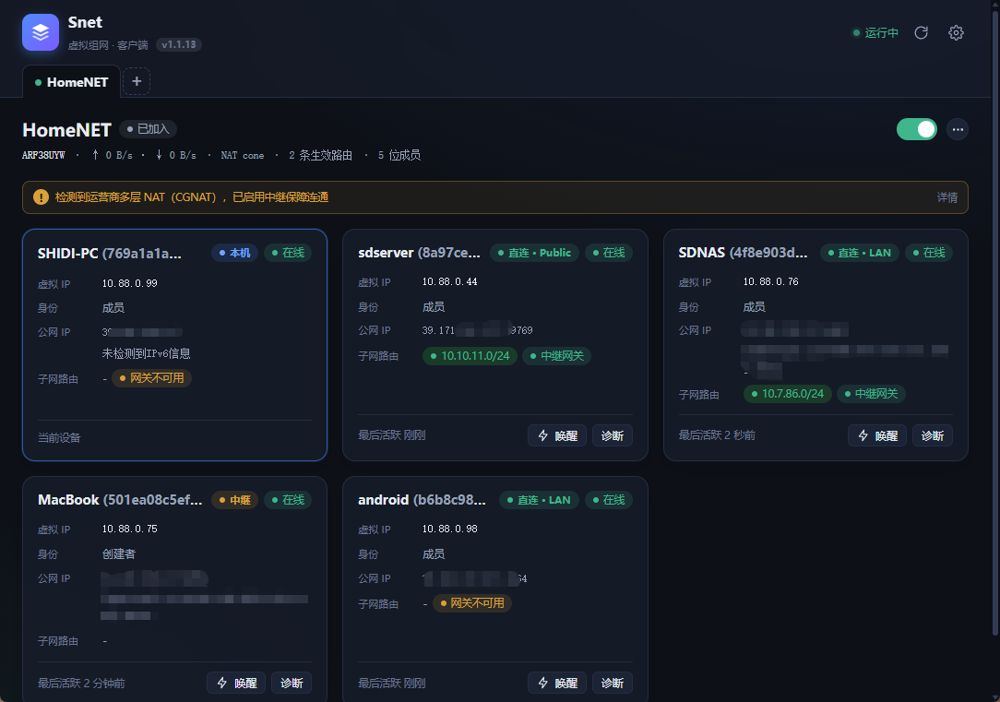
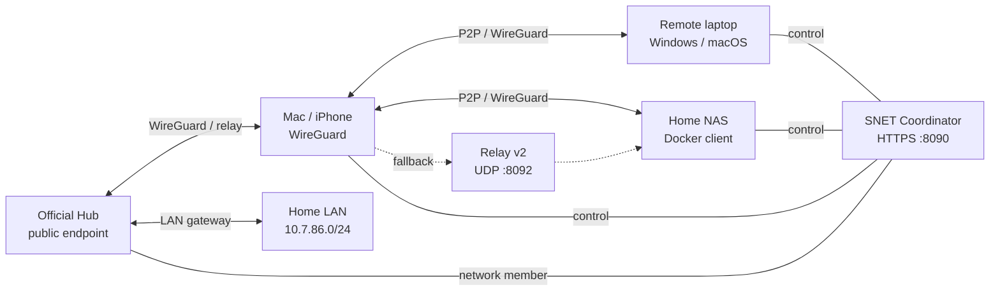

<div align="center">

# SNET

**无需公网 IP，扫码即连的私有 WireGuard 网络。**

WireGuard 加密数据面 · P2P 直连 + 按需中继 · 全平台客户端 · 标准 WireGuard 移动端接入

[](LICENSE)
[](https://github.com/S-shidi/Snet/releases/latest)
[](https://github.com/S-shidi/Snet/actions/workflows/ci.yml)
[](https://github.com/S-shidi/Snet/actions/workflows/build-mac.yml)
[](https://github.com/S-shidi/Snet/actions/workflows/build-windows.yml)

[](https://github.com/S-shidi/Snet/releases/latest)
[](https://github.com/S-shidi/Snet/releases/latest)
[](https://github.com/S-shidi/Snet/blob/master/deploy-prod/docker-client/README.md)

</div>

<div align="center">
  
</div>

## ✨ 为什么是 SNET

SNET 把 WireGuard 的加密数据面、HTTPS 协调服务、NAT 打洞和按需中继组合成一个开箱即用的私有网络。设备之间优先直连；无法直连时自动切到 Relay；需要让手机或软路由接入时，官方 Hub 会生成标准 WireGuard 配置，扫码即可连入。

- **全平台**：macOS、Windows、Linux / Docker / 群晖 NAS，同一套 Web 控制台体验。
- **P2P 优先，按需中继**：LAN、IPv6、NAT 打洞优先；失败自动 Relay v2，不需要公网 IP。
- **标准 WireGuard 接入**：一键生成 `.conf` 和二维码，手机、软路由、任何标准 WireGuard 客户端都能直接导入。
- **官方 Hub / 原生网关**：无需改造现有 LAN，通过 Hub 或委派路由访问 `10.7.86.0/24` 等内网网段。
- **适合自托管**：单个 Go 二进制、Docker Compose、SQLite/bbolt 持久化，没有外部数据库依赖。

## 🚀 Quick Start

### 1. 部署服务端

在 Linux VPS 上执行：

```bash
curl -fsSL https://raw.githubusercontent.com/S-shidi/Snet/master/scripts/install-server.sh | sudo bash
```

脚本会：

- 安装到 `/opt/snet`
- 生成 Relay 密钥
- 启动 `snet-server` + `snet-relay`
- 输出管理控制台和健康检查地址

生产环境建议配置域名和 TLS，并阅读 [服务端部署文档](deploy-prod/docker-server/README.md)。

管理控制台：

```text
http://<VPS_IP>:8090/admin
```

### 2. 安装客户端

- **macOS**：从 [Latest Release](https://github.com/S-shidi/Snet/releases/latest) 下载 `.dmg`
- **Windows**：从 [Latest Release](https://github.com/S-shidi/Snet/releases/latest) 下载 `Snet-v*-win-Setup.zip`，解压后运行安装程序（ZIP 可避免浏览器拦截未签名 `.exe` 下载）
- **NAS / Linux**：[Docker 客户端部署](deploy-prod/docker-client/README.md)

客户端首次启动后打开 Web 控制台，设置管理密码。

### 3. 创建网络并邀请设备

1. 在客户端点击「添加网络」→「创建新网络」。
2. 把邀请链接发给另一台设备。
3. 对方在「加入网络」中粘贴链接。
4. 需要手机接入时，在 Owner 客户端打开网络详情 → 更多 → **生成 WireGuard 配置**。

## 🧭 架构



- **Client A ↔ Client B**：优先 LAN / IPv6 / NAT 打洞直连。
- **Client ↔ Relay**：直连失败时自动回退，Relay 不读取业务明文。
- **Client ↔ Hub ↔ LAN**：手机或外部 WireGuard 客户端通过 Hub 接入私有网段。

## 🛠 技术栈

| 层 | 实现 |
|---|---|
| 数据面 | WireGuard（wireguard-go） |
| 协调面 | Go + HTTPS + bbolt |
| 中继 | Relay v2，signed ticket，多实例候选 |
| 客户端 | Wails v3（macOS / Windows），Docker + Nginx + Web UI |
| 移动接入 | 标准 WireGuard `.conf` + QR |
| CI/CD | GitHub Actions（macOS DMG、Windows NSIS、Docker ACR） |

## 📦 服务端 / 客户端

服务端、Relay 和客户端镜像：

```text
crpi-0ro5v5xbjp4autp9.cn-hangzhou.personal.cr.aliyuncs.com/snet/snet-server:v1.1.9
crpi-0ro5v5xbjp4autp9.cn-hangzhou.personal.cr.aliyuncs.com/snet/snet-relay:v1.1.9
crpi-0ro5v5xbjp4autp9.cn-hangzhou.personal.cr.aliyuncs.com/snet/snet-client:v1.1.9
```

## 🔐 安全

- 数据面端到端由 WireGuard 加密；协调服务不接触业务明文。
- 服务端使用 HTTPS、Bearer Token、速率限制和严格 JSON body 限制。
- 客户端设备身份持久化；账号密码使用 bcrypt。
- 生成的 WireGuard 私钥只保存在本机 daemon 配置，不上传协调服务器。
- 漏洞披露：请通过 GitHub Security Advisories 私下报告，不要公开 Issue。

## 🧑‍💻 开发

```bash
go test ./...
./scripts/build-release.sh
```

客户端 UI：

```bash
cd desktop-windows/frontend && ./build-frontend.sh
```

## 📚 文档

- [服务端部署（Docker / TLS / Relay）](deploy-prod/docker-server/README.md)
- [Docker 客户端 / 群晖 NAS](deploy-prod/docker-client/README.md)
- [VPS 部署记录](docs/VPS-DEPLOY-VIA-HOSTODO.md)
- [部署环境与路径](docs/DEPLOYMENTS.md)
- [贡献指南](CONTRIBUTING.md)
- [安全策略](SECURITY.md)

## 📄 许可证

SNET 采用按组件拆分许可：

- 客户端组件：[BSD 3-Clause](LICENSE)
- 服务端与 Relay 组件：[AGPL-3.0-only](LICENSE)

闭源商业使用服务端代码需要单独商业许可，见 [COMMERCIAL.md](COMMERCIAL.md)。

---

<div align="center">
  <sub>Built with WireGuard, Go, Wails and a lot of NAT traversal.</sub>
</div>
